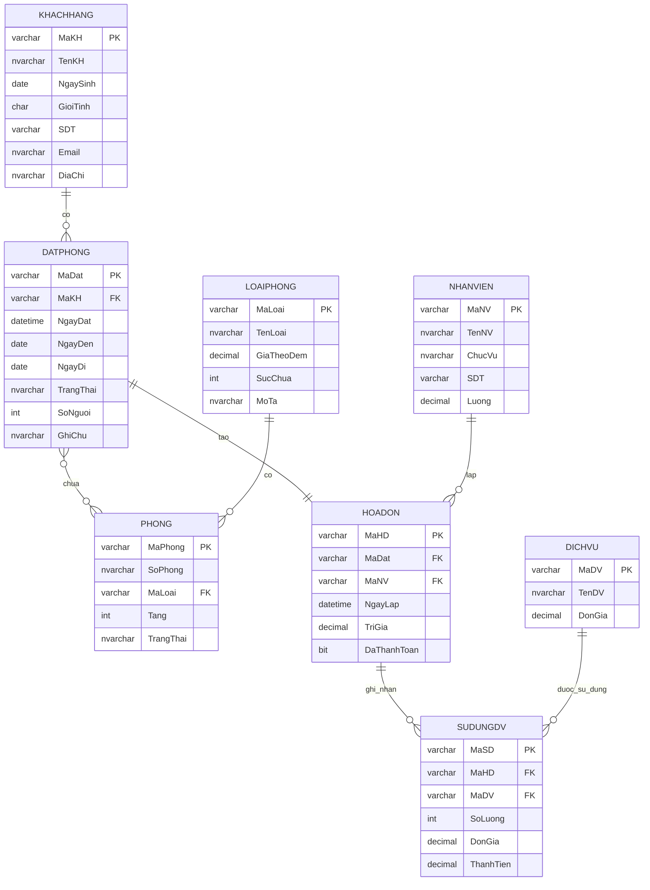

# ERD — Quản lý khách sạn

Mô tả ngắn:
- Khách hàng có nhiều đơn đặt phòng.
- Một đơn đặt phòng chứa nhiều phòng.
- Phòng thuộc một loại phòng.
- Một đơn đặt phòng sinh ra một hóa đơn.
- Hóa đơn có nhiều dịch vụ sử dụng.
- Hóa đơn do một nhân viên lập.
